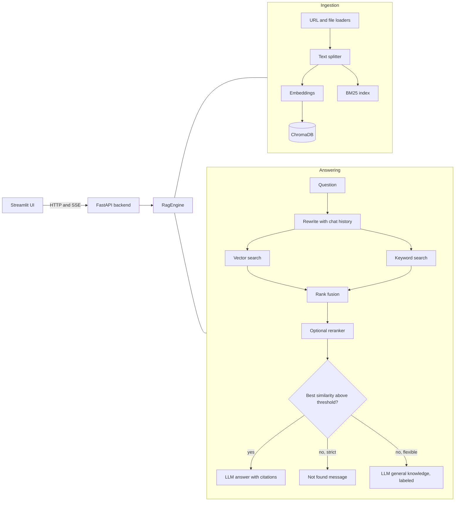

# Source-Grounded Research Assistant

Ask questions about your own documents and get answers that cite the exact passages they came from. If the documents do not cover the question, the assistant says so instead of guessing.

It started as a real estate article reader. The domain is now just a setting, so the same pipeline works for finance, legal, technical or general documents. Real estate is still included as one preset.

Built with LangChain, ChromaDB, HuggingFace embeddings, Groq, FastAPI and Streamlit.

## What it does

- Reads web pages and uploaded PDF, DOCX, TXT and Markdown files
- Finds relevant passages with hybrid search (vector search plus BM25 keyword search, merged with reciprocal rank fusion), with an optional cross-encoder reranker
- Answers with numbered citations like [1] and shows the matching snippets
- Refuses when the best match is below a similarity threshold, before the LLM is called
- Offers two modes: strict (say "not found") and flexible (answer from general knowledge with a fixed warning label)
- Handles follow-up questions by rewriting them into standalone questions using the chat history
- Streams answers token by token
- Ships with an evaluation harness that measures retrieval quality, answer accuracy, faithfulness and refusal behavior

## Architecture



## Quick start

Python 3.10 or newer.

```bash
python -m venv .venv
source .venv/bin/activate          # Windows: .venv\Scripts\activate
pip install -r requirements.txt
cp .env.example .env               # then put your GROQ_API_KEY in .env
```

Start the backend, then the UI, in two terminals:

```bash
uvicorn api:app --reload           # API on http://localhost:8000 (docs at /docs)
streamlit run main.py              # UI on http://localhost:8501
```

Add a URL or upload a file in the sidebar, then ask a question.

## API

| Method | Path | Purpose |
|---|---|---|
| GET | `/health` | Liveness check |
| GET | `/domains` | Available domain presets |
| GET | `/documents` | Indexed documents with chunk counts |
| DELETE | `/documents/{id}` | Remove a document |
| POST | `/ingest/urls` | Index one or more URLs |
| POST | `/ingest/files` | Index uploaded files (multipart) |
| POST | `/ask` | Answer a question, returns JSON |
| POST | `/ask/stream` | Same, as server-sent events (`meta`, `token`, `final`) |

Example:

```bash
curl -X POST localhost:8000/ask -H "Content-Type: application/json" \
  -d '{"question": "What was the 30-year fixed rate?", "mode": "strict", "domain": "real_estate"}'
```

## Configuration

All settings live in `config.py` and can be overridden in `.env`. See `.env.example` for the full list. The ones that matter most:

| Setting | Default | What it controls |
|---|---|---|
| `RETRIEVAL_STRATEGY` | `hybrid` | `vector`, `hybrid` or `hybrid_rerank` |
| `MIN_RELEVANCE` | `0.25` | Similarity the best match must reach before the question counts as covered |
| `TOP_K` | `5` | Passages sent to the model |
| `CHUNK_SIZE` / `CHUNK_OVERLAP` | `800` / `120` | Text splitting |
| `DEFAULT_MODE` | `strict` | Behavior when sources do not cover the question |
| `GROQ_MODEL` | `openai/gpt-oss-120b` | Chat model |

To add a domain, add one entry to `DOMAIN_PRESETS` in `prompt.py`.


## Evaluation

I measured the system on 30 questions (22 answerable, 8 not covered by the documents) over 4 documents about the Jio Platforms IPO. The documents are research notes written from public news and IPO data sites, saved in `evaluation/corpus/` with their source links. Settings: top 5 passages, chunk size 800, relevance threshold 0.25, embeddings `all-MiniLM-L6-v2`, Groq `openai/gpt-oss-120b`.

**Retrieval: is the right passage in the top 5?**

| Strategy | Hit rate | MRR |
|---|---|---|
| Vector search only | 68% (15 of 22) | 0.62 |
| Hybrid (vector + BM25) | 86% (19 of 22) | 0.69 |

**Answers (hybrid retrieval, strict mode)**

| Metric | Result |
|---|---|
| Answer accuracy (answerable questions) | 77% (17 of 22) |
| Faithfulness (LLM judge) | 100% |
| Correctly refused (not covered) | 100% (8 of 8) |
| Wrongly refused (answerable) | 5% (1 of 22) |
| Latency, average / 95th percentile | 6.1 s / 8.8 s |

What I learned:
- Hybrid search raised the hit rate from 68% to 86%, because many questions contain exact numbers and names that keyword search finds better than embeddings.
- The similarity threshold only blocks off-topic questions. Six of the eight uncovered questions were about Jio but not in the documents (CEO, 5G users, dividend and so on), and they score high on similarity. The prompt rule ("say not found if the passages do not contain the answer") refused all of them, so the two layers work together.
- The reranker option is implemented but was not part of this evaluation.

Caveats: the set is small and the documents are few, so treat the numbers as indicative. Answer accuracy is checked by keyword matching and was not reviewed by hand, so it may undercount correct answers phrased differently. Faithfulness uses an LLM as judge.

Reproduce:

```bash
python -m evaluation.run_eval --strategies vector hybrid --gen-strategy hybrid --sleep 2
```

See [EVALUATION.md](EVALUATION.md) for what each metric means and how to build your own question set.

## Design decisions

- **Refusal is decided in code, not in the prompt.** Asking a model to "say you don't know" is unreliable. The similarity gate in `rag.py` blocks uncovered questions before any LLM call, which also saves cost.
- **Hybrid retrieval.** Embeddings miss exact tokens such as numbers, names and codes. BM25 catches them. Rank fusion merges both lists without needing comparable scores.
- **A plain class instead of a legacy chain.** `RagEngine` uses LCEL prompts and streaming directly, so every step is visible and testable. The LLM and embeddings can be injected, which is how the tests run without API keys.
- **Replace, do not duplicate.** Each URL or file name maps to a stable document id, so re-adding a source replaces its old chunks.
- **Basic URL safety.** Private and local addresses are rejected so a hosted copy cannot be pointed at internal services.

## Limitations

- The similarity gate uses the best vector match. A question that only matches on exact keywords can be refused even if BM25 would have found it. Tune `MIN_RELEVANCE` with the evaluation script.
- Scanned PDFs need OCR first. Only text-based PDFs are read.
- Tables inside PDFs are flattened to plain text.
- The URL check does not follow redirects, so a public page that redirects to a private address is not caught.
- There is no login. Put the API behind authentication before exposing it publicly.
- The faithfulness score uses an LLM as judge, which is useful but not perfect.
- Evaluated on a small set (30 questions, 4 documents). Numbers are indicative, not a benchmark.

## Project layout

```
api.py              FastAPI backend
main.py             Streamlit UI (talks to the API)
rag.py              RagEngine: ingestion, retrieval, grounding gate, streaming
prompt.py           Domain presets and prompts
loaders.py          URL and file loaders, document ids, URL safety check
bm25.py             Keyword index
config.py           Settings
evaluation/         Eval harness, sample corpus, sample question set
tests/              pytest suite (fake LLM and embeddings, no API key needed)
```

## Tests

```bash
pip install -r requirements-dev.txt
pytest
```
